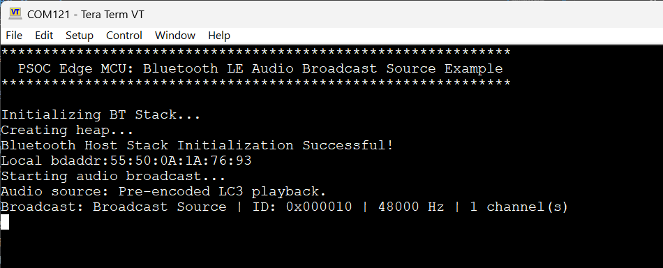
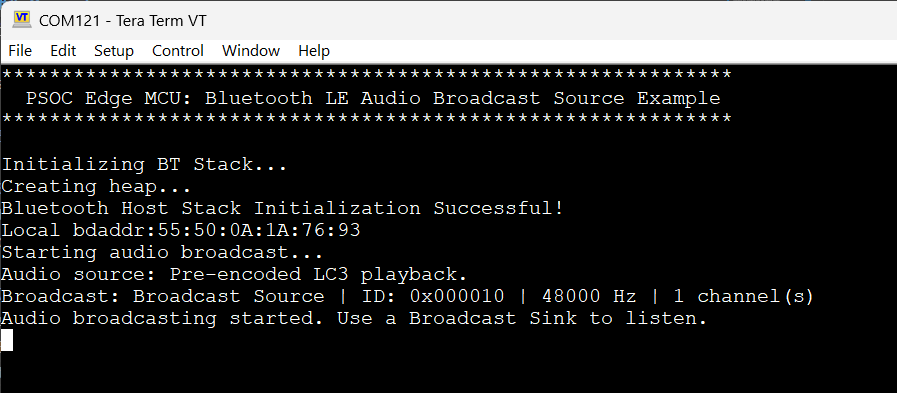

# PSOC&trade; Edge MCU: Bluetooth&reg; LE Audio Broadcast Source

This code example demonstrates Bluetooth&reg; LE Audio Broadcast Source functionality with PSOC&trade; Edge E84 MCU as the Bluetooth&reg; host and AIROC&trade; CYW55513 Wi-Fi & Bluetooth&reg; combo chip as the Bluetooth&reg; controller using the PSOC&trade; Edge E84 Evaluation Kit.

Using this code example, the kit becomes the Broadcast Source device that transmits continuous audio from a looped built-in sample to a compatible Bluetooth&reg; LE Audio Broadcast Sink.

For the Broadcast Source functionality, the application transmits encoded audio frames over the Bluetooth&reg; Isochronous Channels (ISOC). The default configuration uses bundled Low Complexity Communications Codec (LC3) frames; optional runtime encoding uses Google liblc3 v1.0.3 to encode the built-in pulse-code modulation (PCM) recording.

This code example has a three project structure: CM33 secure, CM33 non-secure, and CM55 projects. All three projects are programmed to the external QSPI flash and the initial boot-up sequence is executed from the external flash in Execute in Place (XIP) mode. Extended boot launches the CM33 secure project from a fixed location in the external flash, which then configures the protection settings and launches the CM33 non-secure application. Additionally, CM33 non-secure application enables CM55 CPU and launches the CM55 application. During the startup of the CM55 application, most of the code segments are copied from the external flash to internal memories to ensure faster execution.

The entire Broadcast Source application (including the Bluetooth&reg; Host Stack, audio frame generation, and optional LC3 encoder) runs on the CM55 CPU. The CM33 non-secure application does not perform any operation apart from launching the CM55 application and basic configurations before putting the CPU into DeepSleep mode.

[Provide feedback on this code example.](https://community.infineon.com)

See the [Design and implementation](docs/design_and_implementation.md) for the functional description of this code example.

## Requirements

- [ModusToolbox&trade;](https://www.infineon.com/modustoolbox) v3.9 or later (tested with v3.9)
- Board support package (BSP) minimum required version: 1.0.0
- Programming language: C
- Associated parts: All PSOC&trade; Edge E84 MCU parts

## Supported toolchains (make variable 'TOOLCHAIN')

- GNU Arm&reg; Embedded Compiler v14.2.1 (`GCC_ARM`) – Default value of `TOOLCHAIN`
- Arm&reg; Compiler v6.22 (`ARM`)
- IAR C/C++ Compiler v9.70.4 (`IAR`)
- Arm&reg; Toolchain for Embedded v22.1 (`LLVM_ARM`)

## Supported kits (make variable 'TARGET')

- [PSOC&trade; Edge E84 Evaluation Kit](https://www.infineon.com/KIT_PSE84_EVAL) (`KIT_PSE84_EVAL_EPC2`) – Default value of `TARGET`
- [PSOC&trade; Edge E84 Evaluation Kit](https://www.infineon.com/KIT_PSE84_EVAL) (`KIT_PSE84_EVAL_EPC4`)

## Hardware setup

This example uses the board's default configuration. See the kit user guide to ensure that the board is configured correctly.

Ensure the following jumper and pin configuration on board:
- BOOT SW must be in the HIGH/ON position
- J20 and J21 must be in the tristate/not connected (NC) position

## Software setup

See the [ModusToolbox&trade; tools package installation guide](https://www.infineon.com/ModusToolboxInstallguide) for information about installing and configuring the tools package.

The source does not require the ModusToolbox&trade; Audio SW Codecs Tech Pack. Use Library Manager to resolve the project dependencies, including Google liblc3 v1.0.3 for runtime encoding.

Install a terminal emulator  if you do not have one. Instructions in this document use [Tera Term](https://teratermproject.github.io/index-en.html).

## Operation

See [Using the code example](docs/using_the_code_example.md) for instructions on creating a project, opening it in various supported IDEs, and performing tasks, such as building, programming, and debugging the application within the respective IDEs.

1. On a second kit, build and program the [PSOC&trade; Edge Broadcast Sink CE](https://github.com/Infineon/mtb-example-psoc-edge-btstack-broadcast-sink#operation) once the broadcast sink is initiated, the source discovers and synchronizes to the broadcast sink without pairing

2. Set the `ENABLE_LC3_ENCODING` variable in the *common.mk* file

   1. `ENABLE_LC3_ENCODING=0`: Pre-encoded LC3 frames repeat every 6.51 seconds at 48 kHz, 10 ms, and 100 bytes per channel
   2. `ENABLE_LC3_ENCODING=1`: Google liblc3 v1.0.3 encodes the built-in 48 kHz PCM recording at runtime

3. Connect the board to your PC using the provided USB cable through the KitProg3 USB connector

4. Open a terminal program and select the KitProg3 COM port. Set the serial port parameters to 8N1 and 115200 baud

5. Set the desired audio configuration in the *common.mk* file using the `AUDIO_CONFIG` variable. Match this setting on the sink

   1. `AUDIO_CONFIG=MONO`: Transmit one channel. This is the default configuration
   2. `AUDIO_CONFIG=STEREO`: Transmit left and right channel frames within one BIS. Set `AUDIO_CONFIG=STEREO` on both boards, then clean, rebuild, and program both applications

   When `ENABLE_LC3_ENCODING=1`, you can select a different sampling rate or frame duration by choosing the appropriate `DEFAULT_BIS_CODEC` following preset in *broadcast_source.c*:

   Sampling rate | 7.5 ms | 10 ms
   ------------- | ------ | -----
   8 kHz | `BAP_CODEC_CONFIG_8_1_2` | `BAP_CODEC_CONFIG_8_2_2`
   16 kHz | `BAP_CODEC_CONFIG_16_1_2` | `BAP_CODEC_CONFIG_16_2_2`
   24 kHz | `BAP_CODEC_CONFIG_24_1_2` | `BAP_CODEC_CONFIG_24_2_2`
   48 kHz | `BAP_CODEC_CONFIG_48_1_2` | `BAP_CODEC_CONFIG_48_2_2` (default)

   For pre-encoded mode when (`ENABLE_LC3_ENCODING=0`) Keep `AUDIO_SAMPLE_RATE_HZ=48000U` for the built-in PCM recording. Rebuild/program the source and reset the sink after changing the preset.

6. Clean, build and program the application on the board

7. After programming, the application starts automatically. Confirm that "PSOC Edge MCU: Bluetooth LE Audio Broadcast Source Example" is displayed on the UART terminal

8. Within a few seconds, the Bluetooth&reg; Stack initialization should be successful and the Bluetooth&reg; advertisement for Broadcast Source will be started automatically along with the terminal output printed as shown

   **Figure 1. Terminal output on program startup**

   

9. Wait for "Audio broadcasting started. Use a Broadcast Sink to listen." This confirms audio broadcasting started

   **Figure 2. Terminal output audio broadcasting started**

   

10. Listen for continuous audio on the sink device.

## Related resources

Resources  | Links
-----------|----------------------------------
Application notes  | [AN235935](https://www.infineon.com/AN235935) – Getting started with PSOC&trade; Edge E8 MCU on ModusToolbox&trade; software   [AN236697](https://www.infineon.com/AN236697) – Getting started with PSOC&trade; MCU and AIROC&trade; Connectivity devices
Code examples  | [Using ModusToolbox&trade;](https://github.com/Infineon/Code-Examples-for-ModusToolbox-Software) on GitHub
Device documentation | [PSOC&trade; Edge MCU datasheets](https://www.infineon.com/products/microcontroller/32-bit-psoc-arm-cortex/32-bit-psoc-edge-arm#documents)   [PSOC&trade; Edge MCU reference manuals](https://www.infineon.com/products/microcontroller/32-bit-psoc-arm-cortex/32-bit-psoc-edge-arm#documents)
Development kits | Select your kits from the [Evaluation board finder](https://www.infineon.com/cms/en/design-support/finder-selection-tools/product-finder/evaluation-board)
Libraries  | [mtb-dsl-pse8xxgp](https://github.com/Infineon/mtb-dsl-pse8xxgp) – Device support library for PSE8XXGP   [retarget-io](https://github.com/Infineon/retarget-io) – Utility library to retarget STDIO messages to a UART port   [btstack-integration](https://github.com/Infineon/btstack-integration) – The btstack-integration hosts platform adaptation layer (porting layer) between AIROC&trade; BTSTACK and Infineon's different hardware platforms
Tools  | [ModusToolbox&trade;](https://www.infineon.com/modustoolbox) – ModusToolbox&trade; software is a collection of easy-to-use libraries and tools enabling rapid development with Infineon MCUs for applications ranging from wireless and cloud-connected systems, edge AI/ML, embedded sense and control, to wired USB connectivity using PSOC&trade; Industrial/IoT MCUs, AIROC&trade; Wi-Fi and Bluetooth&reg; connectivity devices, XMC&trade; Industrial MCUs, and EZ-USB&trade;/EZ-PD&trade; wired connectivity controllers. ModusToolbox&trade; incorporates a comprehensive set of BSPs, HAL, libraries, configuration tools, and provides support for industry-standard IDEs to fast-track your embedded application development

 

## Other resources

Infineon provides a wealth of data at [www.infineon.com](https://www.infineon.com) to help you select the right device, and quickly and effectively integrate it into your design.

## Document history

Document title: *CE243654* – *PSOC&trade; Edge MCU: Bluetooth&reg; LE Audio Broadcast Source*

 Version | Description of change
 ------- | ---------------------
 1.0.0   | New code example
 

All referenced product or service names and trademarks are the property of their respective owners.

The Bluetooth&reg; word mark and logos are registered trademarks owned by Bluetooth SIG, Inc., and any use of such marks by Infineon is under license.

PSOC&trade;, formerly known as PSoC&trade;, is a trademark of Infineon Technologies. Any references to PSoC&trade; in this document or others shall be deemed to refer to PSOC&trade;.

---------------------------------------------------------

(c) 2026, Infineon Technologies AG, or an affiliate of Infineon Technologies AG. All rights reserved.
This software, associated documentation and materials ("Software") is owned by Infineon Technologies AG or one of its affiliates ("Infineon") and is protected by and subject to worldwide patent protection, worldwide copyright laws, and international treaty provisions. Therefore, you may use this Software only as provided in the license agreement accompanying the software package from which you obtained this Software. If no license agreement applies, then any use, reproduction, modification, translation, or compilation of this Software is prohibited without the express written permission of Infineon.
 
Disclaimer: UNLESS OTHERWISE EXPRESSLY AGREED WITH INFINEON, THIS SOFTWARE IS PROVIDED AS-IS, WITH NO WARRANTY OF ANY KIND, EXPRESS OR IMPLIED, INCLUDING, BUT NOT LIMITED TO, ALL WARRANTIES OF NON-INFRINGEMENT OF THIRD-PARTY RIGHTS AND IMPLIED WARRANTIES SUCH AS WARRANTIES OF FITNESS FOR A SPECIFIC USE/PURPOSE OR MERCHANTABILITY. Infineon reserves the right to make changes to the Software without notice. You are responsible for properly designing, programming, and testing the functionality and safety of your intended application of the Software, as well as complying with any legal requirements related to its use. Infineon does not guarantee that the Software will be free from intrusion, data theft or loss, or other breaches (“Security Breaches”), and Infineon shall have no liability arising out of any Security Breaches. Unless otherwise explicitly approved by Infineon, the Software may not be used in any application where a failure of the Product or any consequences of the use thereof can reasonably be expected to result in personal injury.
